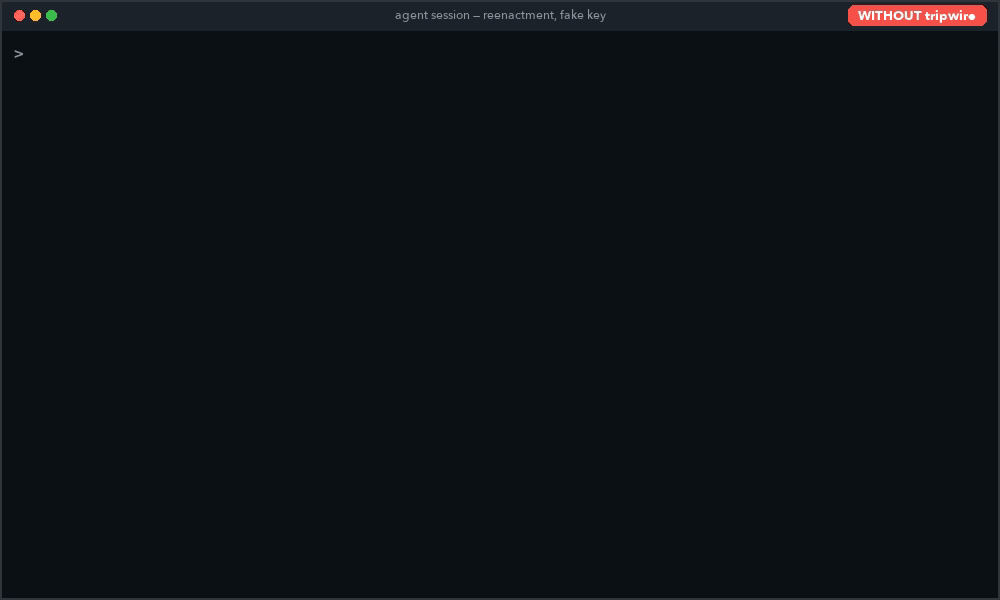
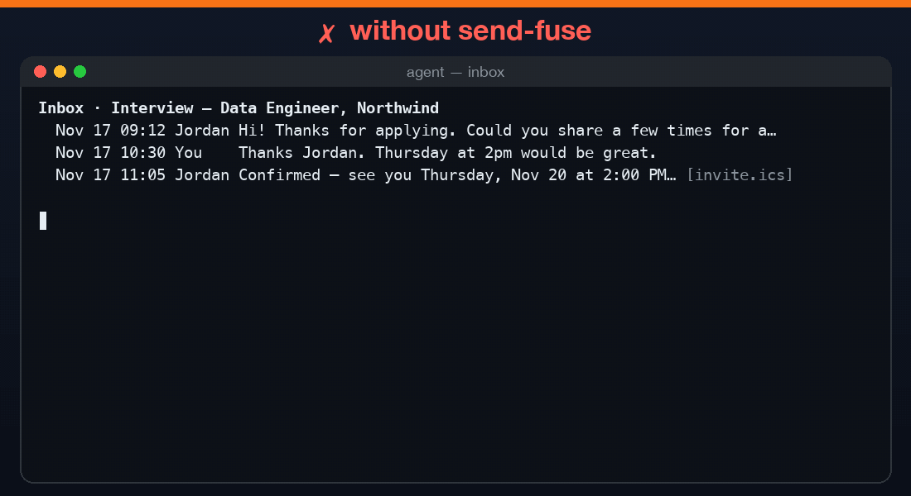
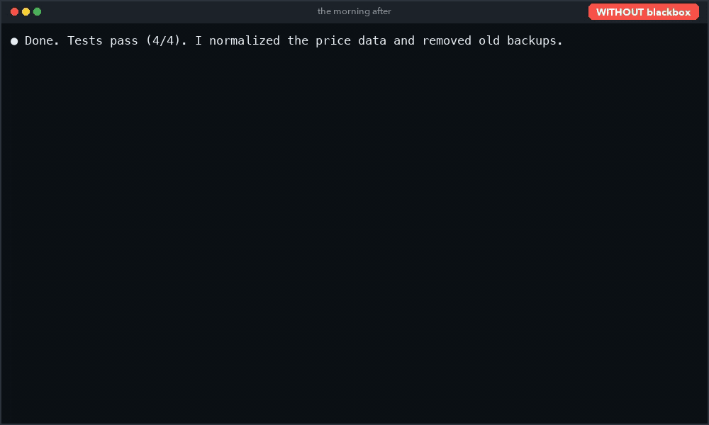
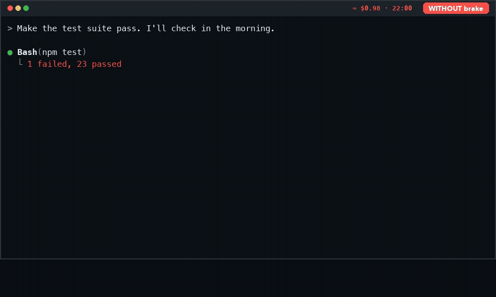
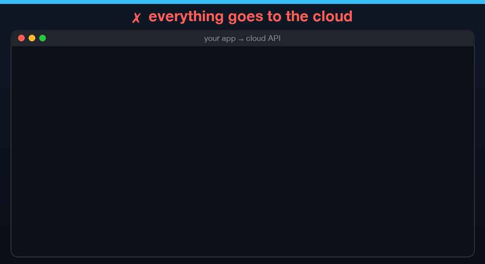

# hands-off

**Six tiny guards that make it safe to let your AI agent work while you're not watching.**

[](https://github.com/JohnSUNLei/hands-off/actions/workflows/tests.yml)


[中文说明](README.zh.md)

Coding agents now run for hours on their own. They read the open web and your inbox, send email, run `curl` and `git push`, and spend money on every turn. What holds people back isn't how smart the agent is — it's whether they dare to look away.

Each tool here stops **one specific accident**. One Python file each, standard library only, **no model decides anything**, nothing leaves your machine. Hook them into Claude Code in one line.



## The six

| | The accident | The guard | |
|---|---|---|---|
| 🦷 | You wrote the rule in `CLAUDE.md`. The agent ignored it anyway. | **[rule-teeth](rule-teeth)** turns the checkable rules into hooks that block the edit | [↓](#rule-teeth--rules-that-bite) |
| ✉️ | Your agent replied with three new times — for a meeting the other side had already confirmed. | **[send-fuse](send-fuse)** reads the live thread before anything is sent | [↓](#send-fuse--a-fuse-before-the-send-button) |
| 🪤 | One line of white text on a web page can get your agent to send your API key to a stranger. | **[tripwire](tripwire)** — once the agent has read something untrusted, every outbound action needs your OK | [↓](#tripwire--prompt-injection-tripwire) |
| 📼 | It worked all night. What did it actually do — and how do you undo the one bad step? | **[blackbox](blackbox)** records a plain-language timeline with before/after of every file | [↓](#blackbox--flight-recorder-with-undo) |
| 🛑 | Stuck on one failing test, it can re-run the same loop until morning — and bill you hundreds of dollars. | **[brake](brake)** stops a task at your dollar / token / time / loop limit, and says why | [↓](#brake--spending-limits-per-task) |
| 🏠 | Most of what you pay the cloud for, a model on your own machine could have done. | **[local-first](local-first)** routes by plain rules — and never silently falls back to the cloud | [↓](#local-first--local-first-routing-with-a-bill) |

**Where to start:** your agent reads web pages or email → **tripwire**. It sends messages for you → **send-fuse**. You leave it running overnight → **brake** + **blackbox**. Your `CLAUDE.md` keeps growing → **rule-teeth**. You pay per token and own a decent Mac or GPU → **local-first**.

## How they're built

- **One file, standard library only.** Read it in ten minutes, vendor it, audit it. No `pip install` needed.
- **No model decides.** Plain rules: the same input always gets the same verdict, and a guard can't be prompt-injected.
- **Local.** No account, no network, no telemetry. The guards that sit in front of an action can only say no.
- **Loud, never silent.** When a guard is unsure or broken it says so; `local-first` refuses rather than quietly sending your request to the cloud; `send-fuse` fails closed.
- **The agent can't loosen its own leash.** Each tool blocks the agent from editing its config or switching it off.
- **Tested.** Every tool ships its own test suite, including hook tests that drive it exactly the way Claude Code does.

Works with **Claude Code** today, through its hooks. `local-first` works with any OpenAI-compatible client; `send-fuse` has a CLI any agent or script can call.

---

### rule-teeth — rules that bite

Reads your `CLAUDE.md` / `AGENTS.md`, sorts every rule into *checkable* / *needs judgment* / *too vague*, and wires the checkable ones into hooks. On the author's own 16-project monorepo: 51 rules, 42 of them never checked by a machine.

```text
rule-teeth blocked this edit — it would break a rule written in your project's rule file:
- [RT1] app.py:2  contains `requests.post`
    rule: Never call `requests.post` directly — only through `llm.py`  (source: CLAUDE.md:3)
```

```bash
git clone https://github.com/JohnSUNLei/hands-off
python3 hands-off/rule-teeth/rule_teeth.py checkup /your/project --out checkup.md   # read-only
python3 hands-off/rule-teeth/rule_teeth.py init /your/project --hook                # give the rules teeth
```

[Full README →](rule-teeth)

### send-fuse — a fuse before the Send button

Before a message goes out, it reads the conversation *as it is now*: already confirmed? newer messages? already replied? a parallel agent sent the same thing a minute ago? Then it blocks the send a careful human wouldn't make — with the reason.



```bash
curl -fsSL https://raw.githubusercontent.com/JohnSUNLei/hands-off/main/send-fuse/sendfuse.py -o sendfuse.py && python3 sendfuse.py demo
```

[Full README →](send-fuse)

### tripwire — prompt-injection tripwire

Doesn't try to *spot* injections with another model. It does taint tracking: once the session has read web pages, mail, downloads or anything written *to an AI*, actions that send data out or touch secrets pause for your OK.

```bash
curl -fsSLo .tripwire/tripwire.py --create-dirs https://raw.githubusercontent.com/JohnSUNLei/hands-off/main/tripwire/tripwire.py && python3 .tripwire/tripwire.py init
```

[Full README →](tripwire)

### blackbox — flight recorder with undo

Every prompt, command, file change (even through shell commands) and web page read, on one timeline page. Undo any single step without losing the rest of the night's work.



```bash
curl -fsSLo .blackbox/blackbox.py --create-dirs https://raw.githubusercontent.com/JohnSUNLei/hands-off/main/blackbox/blackbox.py && python3 .blackbox/blackbox.py init
```

[Full README →](blackbox)

### brake — spending limits per task

Per-task limits on estimated dollars (helper agents included), tokens, minutes, and repeated identical calls. Warns at 80%, stops at 100% with a one-line reason; your next message starts a fresh budget.



```bash
curl -fsSLo .brake/brake.py --create-dirs https://raw.githubusercontent.com/JohnSUNLei/hands-off/main/brake/brake.py && python3 .brake/brake.py init --usd 5
```

[Full README →](brake)

### local-first — local-first routing, with a bill

An OpenAI-compatible proxy: routine work goes to LM Studio / Ollama on your machine, hard reasoning to the cloud, anything containing a secret stays local. If the local model is down, the request fails loudly instead of quietly going to the cloud. `bill` shows what you paid versus all-cloud.



```bash
curl -fsSL https://raw.githubusercontent.com/JohnSUNLei/hands-off/main/local-first/localfirst.py -o localfirst.py && python3 localfirst.py demo
```

[Full README →](local-first)

---

## Run the tests

```bash
python3 run_tests.py            # every tool's suite
python3 run_tests.py tripwire   # just one
```

## Why "hands-off"

AI is moving from answering questions to doing things for us. The next step isn't a smarter model — it's being able to take your hands off the keyboard and trust what happens next. These six cover the accidents that showed up first. More will follow as new ones do.

`send-fuse` exists because of a real one: the author's agent emailed someone a fresh set of times — for a meeting that was already booked. Twice.

## Contributing

Issues and PRs welcome — especially false positives ("it blocked something it shouldn't have"), accidents these tools don't cover yet, and hook support for other agents. Each tool is one file, so a fix is usually a few lines plus a test.

Want guardrails like these set up around your team's agents? [Open an issue](https://github.com/JohnSUNLei/hands-off/issues).

⭐ If one of these saved you from an accident — or you'd like it to — a star helps other people find them.

[MIT License](LICENSE) © 2026 John Sun
