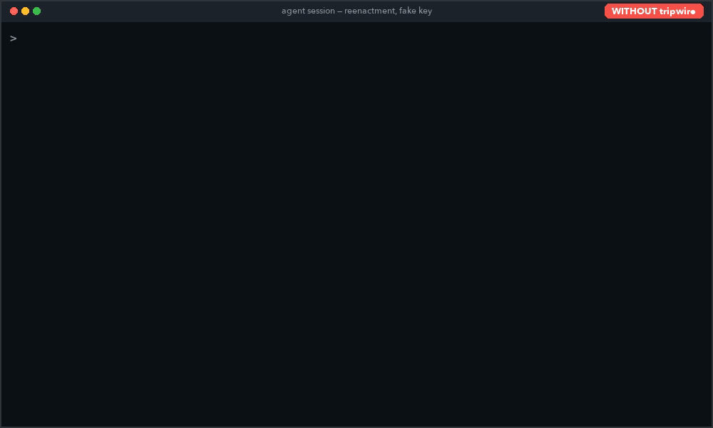
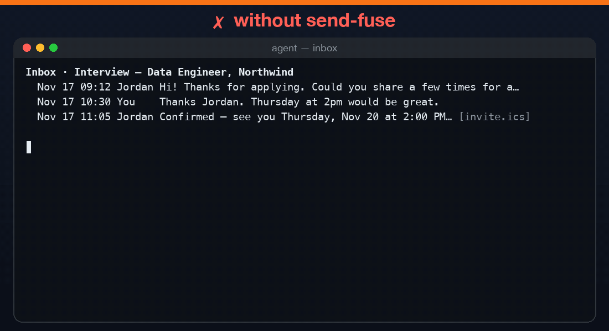
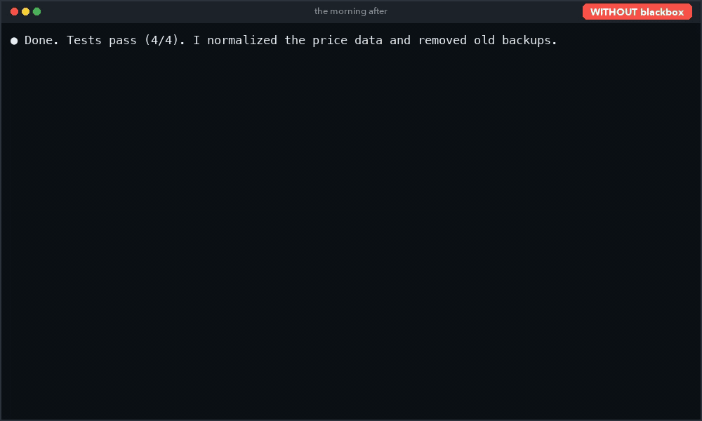
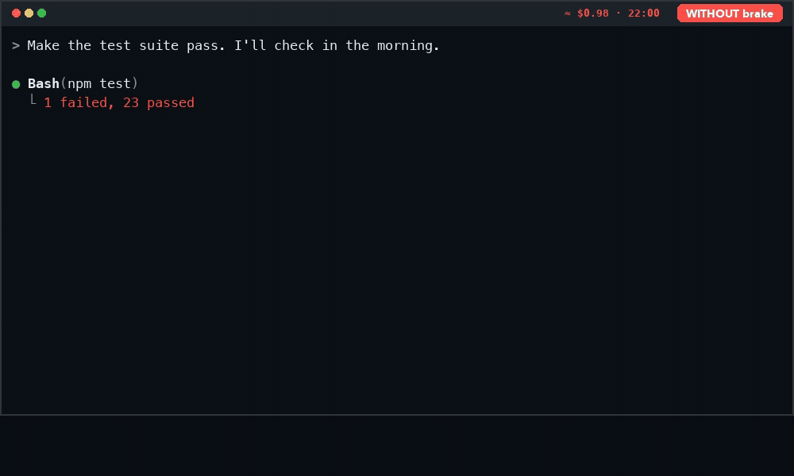
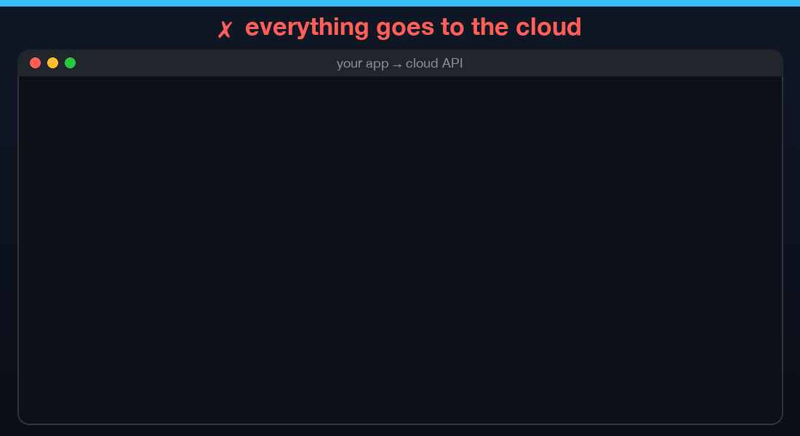

# hands-off · 敢放手

**六个小工具，让你敢把活交给 AI，自己走开。**

[](https://github.com/JohnSUNLei/hands-off/actions/workflows/tests.yml)


[English](README.md)

AI 编程助手现在能自己连跑几个小时：读网页、读你的邮箱、替你发邮件、跑 `curl` 和 `git push`，每一轮都在花钱。卡住大家的不是 AI 不够聪明，而是**不敢放手**。

这里每个工具只防**一种具体的事故**。每个都是一个 Python 文件、只用标准库、**不靠任何模型做判断**、数据不出你的电脑。一行命令接进 Claude Code。



## 六个工具

| | 事故 | 护栏 | |
|---|---|---|---|
| 🦷 | 规则写进了 `CLAUDE.md`，AI 照样不听。 | **[rule-teeth 规则长牙](rule-teeth/README.zh.md)**：把能查的规则变成 hook，违反就拦下 | [↓](#rule-teeth-规则长牙) |
| ✉️ | AI 给招聘官发邮件约面试时间——可这场面试对方早就确认了。 | **[send-fuse 发送保险丝](send-fuse/README.zh.md)**：发出去之前先读一遍最新的会话 | [↓](#send-fuse-发送保险丝) |
| 🪤 | 网页里一行白色小字，就能让 AI 把你的 API 密钥发给陌生人。 | **[tripwire 注入绊线](tripwire/README.zh.md)**：AI 读过不可信内容之后，每个对外动作都要你点头 | [↓](#tripwire-注入绊线) |
| 📼 | 它干了一整夜，到底干了什么？坏掉的那一步怎么单独撤回？ | **[blackbox 黑匣子](blackbox/README.zh.md)**：人话时间线，每个文件都留着改前改后 | [↓](#blackbox-黑匣子) |
| 🛑 | 卡在一个失败的测试上反复重试，一晚上能烧掉几百美元。 | **[brake 刹车](brake/README.zh.md)**：按任务限美元 / token / 时长 / 死循环，超了当场叫停并说明原因 | [↓](#brake-刹车) |
| 🏠 | 花钱送去云端的活，大部分本机模型就能干。 | **[local-first 本地优先](local-first/README.zh.md)**：按明确规则分流，本机挂了绝不悄悄转去云端 | [↓](#local-first-本地优先路由) |

**先装哪个：** AI 会读网页或邮件 → **tripwire**。AI 替你发消息 → **send-fuse**。晚上让它自己跑 → **brake** + **blackbox**。`CLAUDE.md` 越写越长 → **rule-teeth**。按 token 付费、手上有台不错的 Mac 或显卡 → **local-first**。

## 共同的做法

- **一个文件，只用标准库。** 十分钟读完，可以直接拷进你的项目、自己审。不用 `pip install`。
- **不靠模型判断。** 全是明确规则：同样的输入永远得到同样的结论，护栏本身也不会被提示词注入骗过去。
- **本地。** 不注册、不联网、不上报。挡在动作前面的护栏只会说「不」。
- **出错要出声。** 拿不准或者坏了就明说；`local-first` 宁可报错，也不悄悄把请求送去云端；`send-fuse` 出问题时默认拦下。
- **AI 不能给自己松绑。** 每个工具都会拦下 AI 修改它的配置或把它关掉。
- **有测试。** 每个工具自带测试，包括按 Claude Code 真实调用方式驱动 hook 的测试。

现在通过 hook 支持 **Claude Code**。`local-first` 支持任何 OpenAI 兼容的客户端；`send-fuse` 有命令行，任何 AI 或脚本都能调用。

---

### rule-teeth 规则长牙

读你的 `CLAUDE.md` / `AGENTS.md`，把每条规则分成「能自动检查 / 要人判断 / 太模糊」三类，能查的挂进 hook。作者自己的 16 个子项目仓库：51 条规则，42 条从来没被机器检查过。

```bash
git clone https://github.com/JohnSUNLei/hands-off
python3 hands-off/rule-teeth/rule_teeth.py checkup /你的项目 --out 体检报告.md   # 只读体检
python3 hands-off/rule-teeth/rule_teeth.py init /你的项目 --hook                 # 装上牙
```

[完整说明 →](rule-teeth/README.zh.md)

### send-fuse 发送保险丝

发出去之前，先看这个会话**现在**的状态：对方已经确认了？后面有新消息？已经回过了？另一个 AI 一分钟前刚发过同样的内容？细心的人不会按发送的时候，它就不让发，并说明原因。



```bash
curl -fsSL https://raw.githubusercontent.com/JohnSUNLei/hands-off/main/send-fuse/sendfuse.py -o sendfuse.py && python3 sendfuse.py demo
```

[完整说明 →](send-fuse/README.zh.md)

### tripwire 注入绊线

不靠另一个模型去「认出」注入，而是做污点追踪：这个会话一旦读过网页、邮件、下载的文件，或任何「写给 AI 看」的文字，之后往外发数据、碰密钥的动作都先停下来等你点头。

```bash
curl -fsSLo .tripwire/tripwire.py --create-dirs https://raw.githubusercontent.com/JohnSUNLei/hands-off/main/tripwire/tripwire.py && python3 .tripwire/tripwire.py init --lang zh
```

[完整说明 →](tripwire/README.zh.md)

### blackbox 黑匣子

你的每条指令、它跑的每条命令、改的每个文件（包括用 shell 命令改的）、读的每个网页，排在一页时间线上。任何一步都能单独撤销，这一夜别的活一点不丢。



```bash
curl -fsSLo .blackbox/blackbox.py --create-dirs https://raw.githubusercontent.com/JohnSUNLei/hands-off/main/blackbox/blackbox.py && python3 .blackbox/blackbox.py init --lang zh
```

[完整说明 →](blackbox/README.zh.md)

### brake 刹车

按任务限额：估算美元（含子代理）、token、时长、同一个调用反复出现。到 80% 提醒它收尾，到 100% 当场叫停并附一句原因；你发下一条消息就是一份新额度。



```bash
curl -fsSLo .brake/brake.py --create-dirs https://raw.githubusercontent.com/JohnSUNLei/hands-off/main/brake/brake.py && python3 .brake/brake.py init --usd 5 --lang zh
```

[完整说明 →](brake/README.zh.md)

### local-first 本地优先路由

一个 OpenAI 兼容的本地代理：日常活交给本机的 LM Studio / Ollama，难的推理上云，带密钥的内容留在本机。本机模型挂了就明确报错，绝不悄悄转去云端。`bill` 一条命令看你实际付了多少、全走云端要付多少。



```bash
curl -fsSL https://raw.githubusercontent.com/JohnSUNLei/hands-off/main/local-first/localfirst.py -o localfirst.py && python3 localfirst.py demo
```

[完整说明 →](local-first/README.zh.md)

---

## 跑测试

```bash
python3 run_tests.py            # 全部工具
python3 run_tests.py tripwire   # 只跑一个
```

## 为什么叫「敢放手」

AI 正在从回答问题，走向替我们干活。下一步缺的不是更聪明的模型，而是你敢把手从键盘上拿开，并且信得过接下来发生的事。这六个工具防的是最先冒出来的几种事故，新的事故出现了，就再做新的。

`send-fuse` 来自一次真事：作者的 AI 给招聘官发邮件提了几个面试时间——可这场面试早就约好了。还发了两遍。

## 参与

欢迎提 issue 和 PR，尤其是：误拦（「它拦了不该拦的」）、这些工具还没覆盖的事故、给其它 AI 工具接 hook。每个工具只有一个文件，修一个问题通常就是几行代码加一个测试。

想给你团队的 AI 也装上这类护栏？[开个 issue](https://github.com/JohnSUNLei/hands-off/issues)。

⭐ 如果其中哪个帮你躲过了一次事故（或者你希望它帮你躲过），点个星，能让更多人找到它们。

[MIT 许可证](LICENSE) © 2026 John Sun
