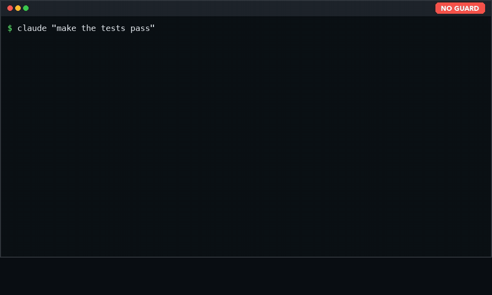

# bar-lock

**When a test fails, your AI has two ways out: fix the code, or make the check easier. bar-lock catches the second one — at the commit, and at "done".**

It reads what a change made *easier* — an assertion deleted or weakened, a test skipped, a tolerance widened, an error swallowed, a pass line lowered — and stops the commit. The waiver is yours to give, from your own terminal; one the agent writes into the diff counts for nothing.

> Part of [**hands-off**](https://github.com/JohnSUNLei/hands-off) — small, local guards that make it safe to let AI agents act for you.



```bash
curl -fsSLo .bar-lock/bar_lock.py --create-dirs https://raw.githubusercontent.com/JohnSUNLei/hands-off/main/bar-lock/bar_lock.py && python3 .bar-lock/bar_lock.py init
```

One Python file. Standard library only. No model calls, no account, no network.
Works with Claude Code today (via hooks); `bar_lock.py check` works anywhere there is git. [中文说明](README.zh.md)

---

## The problem

An agent told to "make the tests pass" can do it two ways. It can fix the code. Or it can make the tests stop checking:

```diff
-    assert total == Decimal("19.99")
+    assert total
```

Suite green. Summary honest-sounding. Nothing fixed. A linter can't see it — it reads the file as it is *now*, and `assert total` is a perfectly good line. The evidence is in the **change**, so bar-lock reads the change.

Existing diff checkers (there are several, and good ones) run as a CLI, a pre-commit hook or a CI step — things an agent can skip with `--no-verify` — and most let you waive a finding with a comment or an ignore-list entry *in the repo*, which the agent can write too. bar-lock runs inside Claude Code's hooks, at the two moments the agent can't talk its way around, and the waiver lives where the agent may not write.

## What it looks at

Only what **this change** made easier. Old habits in the repo are never reported, and tightening is never flagged.

| | what | blocks | only notes |
|---|---|---|---|
| **K1** | assertions | an assertion replaced by a weaker one (`== x` → truthiness); an always-true assertion added; assertions removed from a test and not added back anywhere in the change; a test file deleted with nothing that reappears; a test renamed so it no longer runs | a test function removed; an expected value edited; tests deleted together with the code they test |
| **K2** | disabled tests | `skip` / `xfail` / `expectedFailure` / `.only` / `xit` added; `pytest.skip()` as a plain statement | a brand-new test that is already skipped |
| **K3** | tolerances | `rel_tol`, `abs_tol`, `atol`, `rtol`, `delta`, `approx(abs=…)` widened by ≥10%; `places` / `toBeCloseTo` digits reduced | a smaller widening |
| **K4** | swallowed errors | a new `except Exception: pass` (or bare `except`, `suppress(Exception)`) inside a test, or in a file you list under `gate_globs` | a new empty `catch {}` in JS |
| **K5** | pass lines | `fail_under`, `min_score`, `pass_*`, `coverage … threshold`, `max_failures`, `max_complexity` … lowered or raised the easy way; any number at all in a file you **pin** | a vaguer `…_threshold` moved; a pass line that disappeared |

Python is read from the syntax tree (before and after), JavaScript / TypeScript by pattern. Things that are **not** weakening are left alone: `skipif(sys.platform …)`, `importorskip`, a test moved to another file, assertions folded into `parametrize` or a loop, `assertEqual(a, b)` rewritten as `assert a == b`, tolerances tightened, a test deleted together with the module it imports.

## When it looks

| moment | what happens |
|---|---|
| the agent runs `git commit` | the working tree is compared with `HEAD`; a blocking finding **denies the command**, with the reason and the next step |
| the agent runs `git push` / `gh pr create` | everything committed this session is compared with where the session started — catches what slipped in through a script or `git revert` |
| the agent says it is done (**Stop**) | the working tree is compared with the session start; the agent is sent back to fix it. Refused twice in a row, it stops refusing and says loudly what is still wrong |
| the agent edits bar-lock, its waivers or its hook | denied |

What the agent sees:

```
bar-lock blocked this commit — 5 change(s) made the checks easier instead of making the code right:
  [K5] gate.py:1 — pass line lowered: MIN_PASS_SCORE: 90 → 40   (id 48e6ab0d3323cfaaf36b4534)
  [K1] tests/test_shop.py:8 (test_total) — assertion weakened: assert compute(3, 6.66) == 19.98 → assert compute(3, 6.66)   (id 69f0b185e698dd84b229b157)
  [K3] tests/test_shop.py:12 — tolerance loosened: rel_tol: 1e-09 → 0.5   (id 212cb2eabdc0b0fa4d4950d0)
  [K2] tests/test_shop.py:16 (test_discount) — test disabled: @pytest.mark.skip(reason='flaky')   (id b9b696f0cb64cf471d7c5dee)
  [K4] tests/test_shop.py:20 (test_refund) — 1 new swallowed error(s): except Exception: pass   (id bc48486b1515ad708f8c91a2)
```

…and it is told: fix the code so the *original* check passes, or undo the change; if a change is truly intended, stop and ask the user. Do not retry, do not look for a way around.

## Waivers: the user's, not the agent's

If a change really is intended — you removed a feature, so its tests go — you say so, **from your own terminal**:

```bash
python3 .bar-lock/bar_lock.py waive 69f0b185e698dd84b229b157 --reason "the old check was wrong"
python3 .bar-lock/bar_lock.py waive --current --reason "reviewed all of these"
python3 .bar-lock/bar_lock.py waivers
```

Waivers live in `~/.bar-lock/waivers.json` (outside the repo), keyed by the finding's id — which hashes the *kind of change*, not its line number. The agent can read them but cannot run `waive`, write the file, edit `.bar-lock/`, or take the hooks out of `.claude/settings.json`; those calls are denied. A `# allow` / `# noqa`-style comment written into the diff is not looked at.

## Install

From the root of the project you want to protect:

```bash
python3 path/to/bar_lock.py init              # --lang zh for Chinese messages, --local for settings.local.json
python3 path/to/bar_lock.py init --pin ops/thresholds.json --pin gate.py     # numbers only you may change
```

`init` copies the engine to `.bar-lock/bar_lock.py`, writes `.bar-lock/config.json`, adds `SessionStart`, `PreToolUse` and `Stop` hooks to `.claude/settings.json` (your other hooks are untouched) and git-ignores the per-session state. Start a new Claude Code session to load the hooks. **Uninstall:** `python3 .bar-lock/bar_lock.py uninstall`.

Without Claude Code: `python3 bar_lock.py check` (working tree vs `HEAD`), `check --staged`, `check --base origin/main`, `check --json`. Exit code 0 = nothing blocking, 1 = something blocking, 2 = could not check.

## Config (`.bar-lock/config.json`)

```json
{
  "lang": "en",
  "extra_test_globs": ["checks/**"],
  "gate_globs": ["scripts/gate.py"],
  "pinned": ["ops/thresholds.json"],
  "ignore": ["tests/generated/**"],
  "max_stop_blocks": 2
}
```

`pinned` is the strongest tool: any changed number in a pinned file blocks, in either direction — the numbers are yours.

## Checked against real history

`tests/replay.py` replays a repo's commits through the engine. On **773 non-merge commits** that touch test or test-config files — this author's monorepo, a private TypeScript web app, a small Python repo, and [ComfyUI](https://github.com/comfyanonymous/ComfyUI) — bar-lock would have **blocked 10 (1.3%)**. By commit message, none of the ten hides a failure: five are reverts of a feature (so its tests go too), five are deliberate behaviour changes where tests were rewritten shorter. (I read the messages and a few of the diffs, not every line.) Each would have cost one `waive` command.

Turned around, the same commits are real "assertions removed" diffs written in real code: of the **18** commits that had *added* assertions to a test that survives, **18** were caught when applied backwards (Python only; small sample).

Honest caveats: three false blocks seen on the first pass were fixed and the numbers above are measured on the data it was tuned on, so a repo of yours will differ; JavaScript is pattern-matching and noisier than Python.

## Limits (read these)

- **A diff can't read meaning.** A test rewritten to assert something true but irrelevant, or an expected value edited to match the output, can pass. Edited expected values are surfaced as notes, not blocked.
- **It is a guardrail, not a sandbox.** An agent determined to unhook it with a command that never names bar-lock (`jq 'del(.hooks)' …`) is not caught by bar-lock; Claude Code's own permission prompt is the backstop.
- It sees only what Claude Code's hooks expose. A commit made by something that is not a tool call is caught at `git push` / "done", not at the commit.
- Not covered in v1: filters added to the test command (`--deselect`, `-k "not …"`), timeouts and retry counts, snapshot regeneration, suspicious mocks, languages other than Python and JS/TS.
- Findings that were already there when the session started are not blamed on the agent. A baseline made in the middle of a commit excuses nothing.
- When bar-lock itself breaks, it says so on stderr and lets the action through — never silently.

## Tests

```bash
python3 tests/run_all.py      # 98 tests; builds throwaway git repos, drives the hooks the way Claude Code does
python3 tests/replay.py REPO  # replay a repo's history; --reverse measures recall
```

## License

MIT
