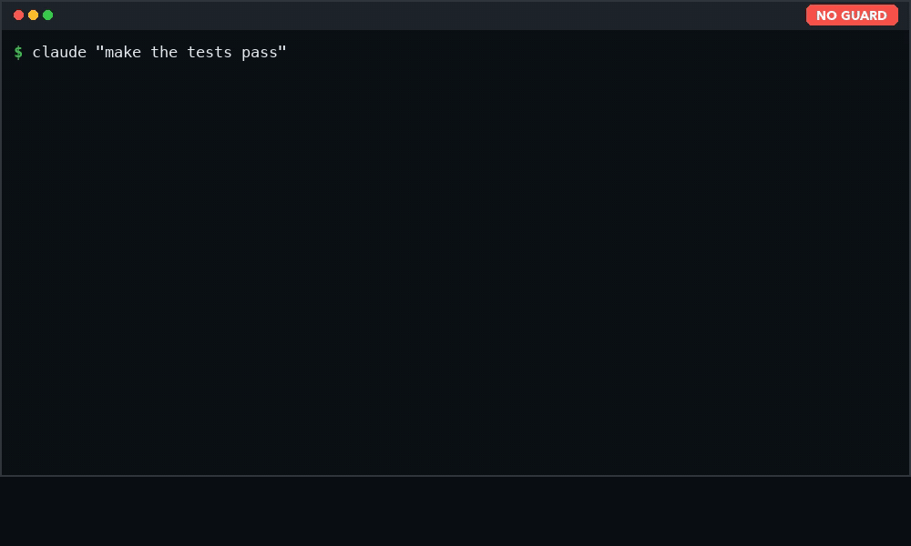

# bar-lock

**测试一红，AI 有两条路：把代码改对，或者把检查变容易。bar-lock 专抓第二条——在它提交的时候，和它说「做完了」的时候。**

它读的是这次改动让检查「变容易」的地方：断言被删或被削弱、测试被停用、容差被放宽、错误被吞掉、及格线数字被调低，然后拦下提交。放行只有**你**能给，在你自己的终端里；AI 自己写在 diff 里的「豁免」一概不算。

> [**hands-off**](https://github.com/JohnSUNLei/hands-off) 的一员——让你敢放手让 AI 干活的小护栏。



```bash
curl -fsSLo .bar-lock/bar_lock.py --create-dirs https://raw.githubusercontent.com/JohnSUNLei/hands-off/main/bar-lock/bar_lock.py && python3 .bar-lock/bar_lock.py init --lang zh
```

一个 Python 文件，只用标准库。不调模型、不用账号、不联网。
目前通过 Claude Code 的 hook 接入；`bar_lock.py check` 在任何有 git 的地方都能用。[English](README.md)

---

## 问题

让 AI「把测试跑过」，它有两种做法：改代码，或者让测试不再检查：

```diff
-    assert total == Decimal("19.99")
+    assert total
```

测试变绿，总结听上去很诚实，什么都没修。代码检查器看不出来——它只看文件**现在**的样子，而 `assert total` 本身是一行没毛病的代码。证据在**改动**里，所以 bar-lock 读改动。

现有的 diff 检查工具（有好几个，也有做得不错的）多数是命令行、pre-commit 或 CI 里的一步——AI 一个 `--no-verify` 就能绕过去；放行也多半写在 diff 注释或仓库里的忽略清单里——AI 同样写得进去。bar-lock 挂在 Claude Code 的 hook 上，选在 AI 绕不开的两个时刻动手，放行记录放在 AI 不许写的地方。

## 查什么

只查**这次改动**让检查变容易的地方。仓库里的老毛病不报；变严格的一律不动。

| | 查什么 | 会拦 | 只提醒 |
|---|---|---|---|
| **K1** | 断言 | 断言被换成更弱的（`== x` → 只看真假）；新增恒真断言；一个测试里的断言少了、整个改动里也没补回；测试文件被删且哪里都没再出现；测试被改名，不再被运行 | 整个测试函数被删；期望值被改；测试和它测的代码一起被删 |
| **K2** | 被停用的测试 | 新增 `skip` / `xfail` / `expectedFailure` / `.only` / `xit`；函数体里直接写 `pytest.skip()` | 新写的测试一出生就是停用的 |
| **K3** | 容差 | `rel_tol`、`abs_tol`、`atol`、`rtol`、`delta`、`approx(abs=…)` 放宽 ≥10%；`places` / `toBeCloseTo` 位数减少 | 放宽幅度更小 |
| **K4** | 吞错 | 测试里（或你在 `gate_globs` 里列出的文件里）新增 `except Exception: pass`、裸 `except`、`suppress(Exception)` | JS 里新增空的 `catch {}` |
| **K5** | 及格线数字 | `fail_under`、`min_score`、`pass_*`、`coverage … threshold`、`max_failures`、`max_complexity` 等被往容易的方向改；**你钉住**的文件里的任何数字变动 | 含糊的 `…_threshold` 被调；某条及格线数字消失了 |

Python 读语法树（改前改后各一份），JavaScript / TypeScript 用模式匹配。**不算**削弱的都放过：`skipif(sys.platform …)`、`importorskip`、测试搬到别的文件、断言收进 `parametrize` 或循环、`assertEqual(a, b)` 改写成 `assert a == b`、容差变严、测试和它导入的模块一起被删。

## 什么时候查

| 时刻 | 做什么 |
|---|---|
| AI 要执行 `git commit` | 拿工作区和 `HEAD` 比；有「拦」级发现就**否决这条命令**，写明原因和下一步 |
| AI 要执行 `git push` / `gh pr create` | 拿本会话提交过的所有东西和会话开始时比——专抓从脚本或 `git revert` 溜进去的 |
| AI 说「做完了」（**Stop**） | 拿工作区和会话开始时比；AI 被打回去改。连着被拒两次后不再拒，改为大声说清楚还有什么没解决 |
| AI 要改 bar-lock 本身、豁免记录或它的 hook | 直接否决 |

## 放行：用户的，不是 AI 的

如果某处改动确实是有意的（比如你拿掉了一个功能，它的测试自然要走），**在你自己的终端里**说一声：

```bash
python3 .bar-lock/bar_lock.py waive 69f0b185e698dd84b229b157 --reason "旧的检查本来就是错的"
python3 .bar-lock/bar_lock.py waive --current --reason "这几条我都看过了"
python3 .bar-lock/bar_lock.py waivers
```

豁免记录在 `~/.bar-lock/waivers.json`（仓库之外），按发现的编号记；编号是「这一类改动」的哈希，不是行号。AI 能读，但不能运行 `waive`、不能写这个文件、不能改 `.bar-lock/`、不能把 hook 从 `.claude/settings.json` 里拿掉，这些调用都会被否决。写进 diff 里的 `allow` / `noqa` 之类注释，bar-lock 根本不看。

## 安装

在要保护的项目根目录：

```bash
python3 path/to/bar_lock.py init --lang zh
python3 path/to/bar_lock.py init --pin ops/thresholds.json --pin gate.py     # 只有你能改的数字
```

`init` 把引擎复制到 `.bar-lock/bar_lock.py`、写 `.bar-lock/config.json`、往 `.claude/settings.json` 加 `SessionStart` / `PreToolUse` / `Stop` 三个 hook（你原有的 hook 不动），并让 git 忽略会话状态。新开一个 Claude Code 会话，hook 才生效。**卸载**：`python3 .bar-lock/bar_lock.py uninstall`。

不用 Claude Code 也行：`python3 bar_lock.py check`（工作区 vs `HEAD`）、`check --staged`、`check --base origin/main`、`check --json`。退出码 0＝没有要拦的，1＝有要拦的，2＝没能检查。

## 用真实历史量过

`tests/replay.py` 把一个仓库的历史提交逐个过一遍引擎。在**773 个**碰过测试或测试配置的非合并提交上——作者自己的 monorepo、一个私有的 TypeScript 网站、一个小 Python 仓库，和 [ComfyUI](https://github.com/comfyanonymous/ComfyUI)——bar-lock 会**拦 10 个（1.3%）**。按提交说明看，这 10 个没有一个是在掩盖失败：5 个是整个功能被回滚（测试自然跟着走），5 个是有意改了行为、测试被改短。（我读了提交说明和其中几个 diff，不是每一行。）每一个只需要一条 `waive` 命令。

反过来用：同样这些提交，倒着应用就是真实代码里写出来的「断言被删」。在**18 个**给仍存活的测试加了断言的提交里，倒着应用后**18 个**都被抓到（只统计 Python；样本小）。

诚实的说明：第一轮看到的 3 个误拦已修，上面的数字是在调参用的数据上量的，你的仓库会有出入；JavaScript 靠模式匹配，比 Python 噪。

## 局限（请读）

- **diff 读不懂意思。** 把测试改成断言一件「为真但无关」的事，或者把期望值改成和输出一致，可以过关。被改的期望值只作为提醒，不拦。
- **它是护栏，不是沙箱。** 一条从不出现 bar-lock 字样的命令（比如 `jq 'del(.hooks)' …`）能把它卸掉，bar-lock 抓不到；Claude Code 自己的权限提示是最后一道。
- 它只看得到 Claude Code 的 hook 暴露的东西。不是工具调用产生的提交，会在 `git push` / 「做完了」时被抓，而不是提交时。
- v1 不覆盖：给测试命令加过滤（`--deselect`、`-k "not …"`）、超时和重试次数、快照重生成、可疑 mock、Python 和 JS/TS 以外的语言。
- 会话开始时就已经存在的发现，不算在 AI 头上。在提交那一刻才临时建的基线，什么也不豁免。
- bar-lock 自己出错时，会在 stderr 说出来并放行——绝不静默。

## 测试

```bash
python3 tests/run_all.py      # 98 个测试；建临时 git 仓库，像 Claude Code 那样喂 hook
python3 tests/replay.py REPO  # 回放一个仓库的历史；--reverse 量召回
```

## 许可

MIT
