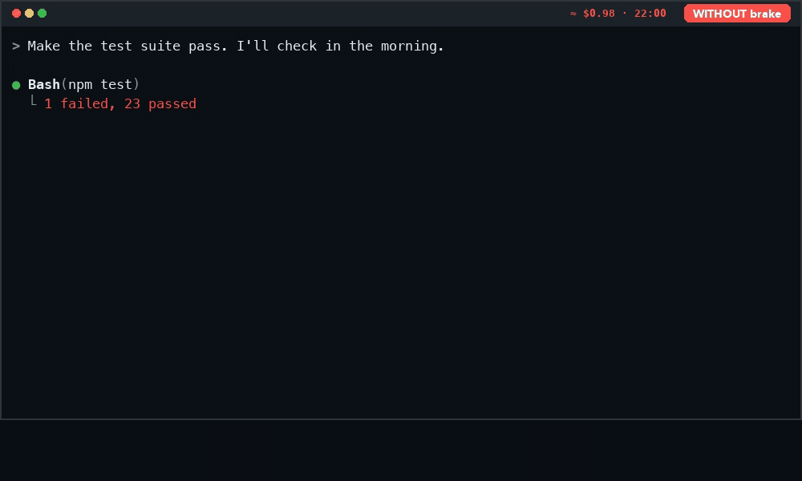

# brake

**Your AI can burn through hundreds of dollars overnight, stuck re-running the same failing command. brake stops it on the spot — and tells you why.**

Per-task limits for coding agents: estimated dollars, tokens, minutes, and loops (the same call over and over). Over a limit, the agent is stopped mid-task with a one-line reason; your next message starts a fresh budget.

> Part of [**hands-off**](https://github.com/JohnSUNLei/hands-off) — small, local guards that make it safe to let AI agents act for you.



```bash
curl -fsSLo .brake/brake.py --create-dirs https://raw.githubusercontent.com/JohnSUNLei/hands-off/main/brake/brake.py && python3 .brake/brake.py init --usd 5
```

One Python file. Standard library only. No model calls, no account, no network, no proxy.
Works with Claude Code today (via hooks). [中文说明](README.zh.md)

---

## Why

Agents now run for hours on their own. When one gets stuck — a test that never passes, a fix that undoes the last fix — it doesn't get tired. It just keeps calling the model, re-reading a context of hundreds of thousands of tokens every time. Usage reports tell you the next morning. brake stops it while it's happening.

```
brake: stopped this task — estimated cost $5.39 reached the $5.00 task limit.
This task: ~$5.39 · 357,555 new tokens · 3 min · 11 tool calls · since “Make the test suite pass. I'll check in the morning.”
To continue, send a new message — a new task gets a fresh budget. To change the limits, edit .brake/config.json.
```

## What it limits

| limit | default | what counts |
|---|---|---|
| `usd` | $10 per task | estimated cost of every model call since your last message, **including helper agents** — tokens from the session transcript × a local price table (input, output, 5-min and 1-hour cache writes, cache reads, fast mode ×2) |
| `tokens` | off | new tokens: fresh input + cache writes + output (cache re-reads are priced in `usd` but not counted here) |
| `minutes` | 120 per task | wall-clock time since your last message |
| `repeat` | 6 | the same tool call (same tool, same input; the description is ignored) 6 times among the last 12 calls |

A task is everything since your last message. The same limits can be set per **session** (`"session": {"usd": 50}`), which then also blocks new prompts until you raise it.

At 80% of a limit, brake warns you and tells the agent to wrap up (finish the current step, say what's done and what's left). At 100%, the tool call is denied and the agent is told to stop (`continue: false`); it stays stopped until you send a message.

## Install

```bash
curl -fsSLo .brake/brake.py --create-dirs https://raw.githubusercontent.com/JohnSUNLei/hands-off/main/brake/brake.py && python3 .brake/brake.py init --usd 5 --minutes 60
```

`init` copies the engine to `.brake/brake.py`, writes your limits to `.brake/config.json`, and adds three hooks (`SessionStart`, `UserPromptSubmit`, `PreToolUse`) to `.claude/settings.json` — nothing else (`--local` uses `settings.local.json`). Options: `--usd`, `--tokens`, `--minutes`, `--repeat`, `--lang zh`.

`python3 .brake/brake.py status` shows the limits and what recent sessions and tasks have used.
`python3 .brake/brake.py uninstall` removes exactly its own hook entries and `.brake/`.

`.brake/config.json`:

```json
{
  "lang": "en",
  "task": {"usd": 5, "tokens": null, "minutes": 60, "repeat": 6},
  "session": {"usd": 50, "tokens": null, "minutes": null},
  "warn_at": 0.8,
  "loop_window": 12,
  "loop_exempt": ["TodoWrite", "TaskOutput", "BashOutput"],
  "prices": {"my-custom-model": [3.0, 15.0, 3.75, 6.0, 0.3]}
}
```

The agent cannot edit `.brake/` or remove the hooks — those calls are denied. It can run `status`.

## How it works

- Before each tool call, brake reads only the new lines of the session transcript (and its helper agents' transcripts), counts each model response once (one response is often written as several lines), and adds up the task.
- Prices are a local table of Anthropic list prices (as of 2026-11) in one place in the file; override or add models in `config.json`. Unknown models are priced at the top of the range, so a mistake errs on the side of stopping.
- Loops are detected from the hook input itself: a fingerprint of each call, compared within a sliding window.
- Everything is deterministic and local: same transcript, same decision.

## Limits (read these)

- **Dollar figures are estimates at API list prices.** On a Pro / Max subscription you're not billed per token; read them as "what this would cost on the API" — still the best signal of a runaway.
- It reads Claude Code's session transcript, whose format is internal and can change between versions. If brake can't read usage, it says so out loud and keeps enforcing time and loop limits — it never silently stops protecting you.
- Usage is counted as Claude Code writes it to the transcript, which can lag one model call behind; a hard budget can be overshot by about one call.
- It acts at tool calls. A model call that uses no tools ends the turn anyway, so it can't run away — but the call that crosses the line still happens.
- It can't see spend outside this project's Claude Code sessions (other tools, other projects, the API directly). For a hard account-wide cap, also set spend limits in the Anthropic Console.

Verified end to end with Claude Code 2.1.322: with a tiny `--usd` limit, the first `echo` ran, the second was denied with the reason above, and the agent stopped.

## Tests

```bash
python3 tests/run_all.py
```

19 tests. The fixture transcript (`tests/fixtures/runaway.jsonl`, generated by `tests/make_fixtures.py`) is a made-up overnight loop — no money was spent making it.

## Part of hands-off

Small, deterministic, local tools for the accidents that happen once you let AI agents act for you. One file each, standard library only, no model calls.

| tool | stops |
|---|---|
| [rule-teeth](../rule-teeth) | the rules in `CLAUDE.md` / `AGENTS.md` that the agent quietly ignores |
| [send-fuse](../send-fuse) | an email or message that should never have gone out |
| [tripwire](../tripwire) | a web page talking your agent into leaking your keys |
| [blackbox](../blackbox) | "what did it do all night?" — a plain-language timeline, and undo |
| **brake** | a stuck agent burning money all night |
| [local-first](../local-first) | paying the cloud for work a model on your machine could do |

⭐ [Star hands-off](https://github.com/JohnSUNLei/hands-off) to follow the series. Questions, bugs, or want guardrails like these around your team's agents? [Open an issue](https://github.com/JohnSUNLei/hands-off/issues).

[MIT License](LICENSE).
