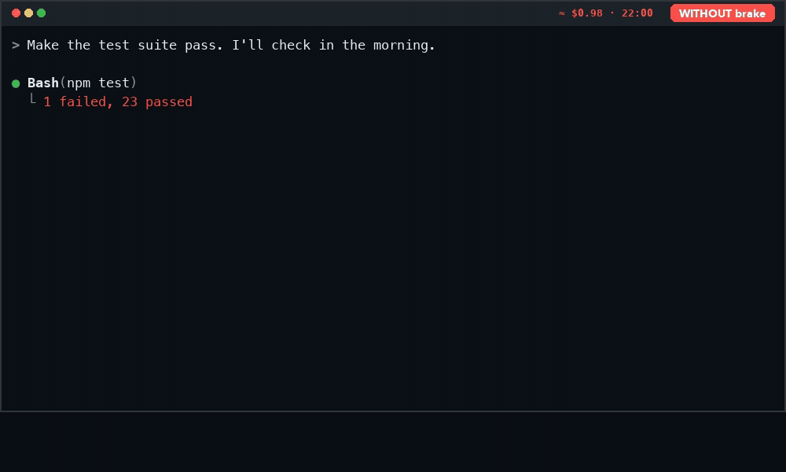

# brake 刹车

**你的 AI 可能一晚上烧掉几百美元——只因为它卡在同一条失败的命令上反复重试。brake 当场叫停，并说清楚为什么。**

给 AI 编程助手按任务设限额：估算美元、token、时长、死循环（同一个调用一遍又一遍）。超了，AI 在任务中途被叫停，附一句原因；你发下一条消息，就是一份新的额度。

> 属于 [**hands-off（敢放手）**](https://github.com/JohnSUNLei/hands-off) 系列 —— 让 AI 替你干活也不出事的几个本地小工具。



```bash
curl -fsSLo .brake/brake.py --create-dirs https://raw.githubusercontent.com/JohnSUNLei/hands-off/main/brake/brake.py && python3 .brake/brake.py init --usd 5 --lang zh
```

一个 Python 文件，只用标准库。不调模型、不注册、不联网、不走代理。
目前通过 hooks 接 Claude Code。[English](README.md)

---

## 为什么要它

现在的 AI 会自己连续跑好几个小时。一旦卡住——测试怎么都过不了、这次的修改撤掉上次的修改——它不会累，只会一遍遍调用模型，每次重读几十万 token 的上下文。用量报表第二天早上才告诉你。brake 在事情发生的当下就把它停住。

```
brake：已叫停这个任务——估算花费 $5.39，到了单个任务上限 $5.00。
本任务：约 $5.39 · 新 token 357,555 · 3 分钟 · 11 次工具调用 · 起点「把测试全部跑通。我明早来看。」
要继续，发一条新消息——新任务有新的额度。要改上限，编辑 .brake/config.json。
```

## 限什么

| 限额 | 默认 | 怎么算 |
|---|---|---|
| `usd` | 每个任务 $10 | 从你上一条消息起每次模型调用的估算费用，**含助手（子代理）**——会话记录里的 token × 本地价目表（输入、输出、5 分钟和 1 小时缓存写入、缓存读取，快速模式 ×2） |
| `tokens` | 不限 | 新 token：新输入 + 缓存写入 + 输出（缓存重读计入 `usd`，不计入这里） |
| `minutes` | 每个任务 120 分钟 | 从你上一条消息起经过的时间 |
| `repeat` | 6 | 最近 12 次调用里，同一个工具调用（同一工具、同一输入，忽略说明文字）出现 6 次 |

「任务」= 从你上一条消息起的全部动作。同样的限额也可以按**会话**设（`"session": {"usd": 50}`），超了连新消息也拦住，直到你调高。

到 80% 时，brake 提醒你，并让 AI 收尾（做完手头这一步，说清做完了什么、还剩什么）。到 100%，这次工具调用被拒绝，AI 被要求停下（`continue: false`）；在你发新消息之前一直保持停止。

## 安装

```bash
curl -fsSLo .brake/brake.py --create-dirs https://raw.githubusercontent.com/JohnSUNLei/hands-off/main/brake/brake.py && python3 .brake/brake.py init --usd 5 --minutes 60 --lang zh
```

`init` 把引擎复制到 `.brake/brake.py`，把限额写进 `.brake/config.json`，在 `.claude/settings.json` 里加三条 hook（`SessionStart`、`UserPromptSubmit`、`PreToolUse`）——别的一概不动（加 `--local` 则写进 `settings.local.json`）。选项：`--usd`、`--tokens`、`--minutes`、`--repeat`、`--lang zh`。

`python3 .brake/brake.py status` 显示限额和最近的会话、任务用了多少。
`python3 .brake/brake.py uninstall` 只删它自己的 hook 条目和 `.brake/`。

AI 不能改 `.brake/`、不能删 hooks——这些调用一律拒绝。它可以跑 `status`。

## 原理

- 每次工具调用之前，brake 只读会话记录（以及助手的记录）里新增的行，每个模型回复只算一次（一个回复常常被写成好几行），把这个任务累加起来。
- 价格是文件里一处本地价目表（Anthropic 2026-11 的公开价）；可在 `config.json` 里覆盖或添加模型。不认识的模型按最贵的档算，宁可早停。
- 死循环直接从 hook 输入里判断：给每次调用算一个指纹，在滑动窗口里比对。
- 全部确定、本地：同样的记录，同样的结论。

## 局限（请读）

- **美元是按 API 公开价的估算。** 用 Pro / Max 订阅时并不按 token 收费；把它理解为「放在 API 上要花多少」——仍然是判断失控的最好信号。
- 它读的是 Claude Code 的会话记录，那是内部格式，版本之间可能变。读不到用量时，brake 会明确说出来，并继续执行时长和死循环限额——绝不悄悄停止保护。
- 用量以 Claude Code 写进记录的时间为准，可能晚一次模型调用；硬预算可能多超出大约一次调用。
- 它在工具调用处起作用。不用工具的模型调用本来就会结束这一轮，跑不掉——但越线的那一次调用仍会发生。
- 它看不到这个项目 Claude Code 会话之外的花费（别的工具、别的项目、直接调 API）。要账户级的硬上限，请同时在 Anthropic Console 设置花费上限。

已用 Claude Code 2.1.322 端到端验证：把 `--usd` 设得极小，第一条 `echo` 执行了，第二条被拒并给出上面的原因，AI 随即停下。

## 测试

```bash
python3 tests/run_all.py
```

19 个测试。夹具记录（`tests/fixtures/runaway.jsonl`，由 `tests/make_fixtures.py` 生成）是虚构的通宵死循环——做它没花一分钱。

## 系列：hands-off（敢放手）

专防「放手让 AI 干活之后会出的事故」的小工具，每个都是单文件、只用标准库、不调模型。

| 工具 | 防什么 |
|---|---|
| [rule-teeth 规则长牙](../rule-teeth/README.zh.md) | `CLAUDE.md` / `AGENTS.md` 里写了、AI 却悄悄不听的规则 |
| [send-fuse 发送保险丝](../send-fuse/README.zh.md) | 不该发出去的邮件和消息 |
| [tripwire 注入绊线](../tripwire/README.zh.md) | 网页里一行小字，骗 AI 把你的密钥发出去 |
| [blackbox 黑匣子](../blackbox/README.zh.md) | 「它昨晚到底干了什么？」—— 人话时间线 + 一键撤销 |
| **brake 刹车** | AI 卡在死循环里烧一整晚的钱 |
| [local-first 本地优先](../local-first/README.zh.md) | 本机模型就能干的活，却花钱送去云端 |

⭐ 觉得有用，[给 hands-off 点个星](https://github.com/JohnSUNLei/hands-off)，系列更新第一时间看到。有问题、发现 bug，或者想给你团队的 AI 也装上这类护栏？[开个 issue](https://github.com/JohnSUNLei/hands-off/issues)。

[MIT 许可证](LICENSE)。
