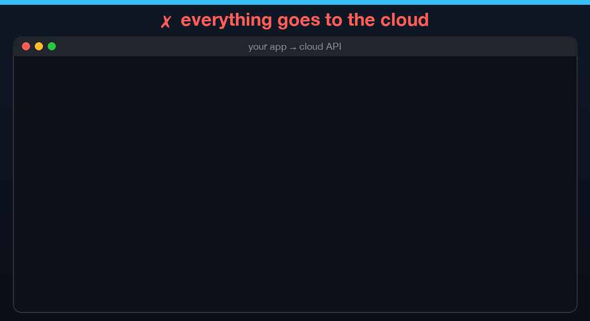

# local-first

**You know where every request went, and what it cost.**
local-first is an OpenAI-compatible proxy that routes each request by plain rules — to LM Studio / Ollama on your machine, or to the cloud — and writes every one into a ledger: where it went, how many tokens, what it cost (estimated). Routine work stays on your machine; the cloud money you don't spend is a side effect.

Three guarantees:

1. **A secret stays on your machine.** A prompt that contains an API key, a private key or a password — or carries a `private` tag — is refused with `403` instead of being sent to a cloud backend. On by default; turning it off is an explicit config change.
2. **If your local model is down, you get an error — never a silent cloud call.** The request fails with `503` and says what's wrong.
3. **Every cloud call is the result of a rule you wrote, and it shows up on the bill.** A request only reaches the cloud through a route in your config or because you asked for it by name; every request, refused ones included, is a line in the ledger.

> Part of [**hands-off**](https://github.com/JohnSUNLei/hands-off) — small, local guards that make it safe to let AI agents act for you.

[中文说明](README.zh.md)



```bash
curl -fsSL https://raw.githubusercontent.com/JohnSUNLei/hands-off/main/local-first/localfirst.py -o localfirst.py && python3 localfirst.py demo
```

One file. Python standard library only. The demo runs fake backends on localhost — no key, no model, nothing leaves your machine.

## Use it (2 minutes)

```bash
python3 localfirst.py init       # writes local-first.json — set your models there
python3 localfirst.py check --deep   # live probe: is each backend up, is the model there, does it actually answer?
python3 localfirst.py serve      # http://127.0.0.1:8484/v1
```

Point any OpenAI-compatible client at it — the OpenAI SDKs, LangChain, Continue, Cline, aider, your scripts:

```python
from openai import OpenAI
client = OpenAI(base_url="http://127.0.0.1:8484/v1", api_key="unused")
client.chat.completions.create(model="auto", messages=[{"role": "user", "content": "Summarize this: …"}])
```

Every response says where it ran: `X-Local-First-Where: local`, `X-Local-First-Backend`, `X-Local-First-Model`, `X-Local-First-Rule`.

```
$ python3 localfirst.py bill
local-first bill (estimate) · November 2026

  backend                requests  tokens in  tokens out       cost
  lmstudio (local)           1321      17.2M        1.1M      $0.00
  cloud                       179       2.3M        147k      $9.25
  ─────────────────────────────────────────────────────────────────
  you paid (est.)                                             $9.25
  all-cloud would have cost (est.)                           $76.89
  saved (est.)                                               $67.64 (88%)

  88% of 1500 requests ran on this machine.
  estimate: prices come from your config; local electricity and compute are not counted.
  all-cloud priced at $3 in / $15 out per million tokens (set yours in local-first.json).
```
<sub>(That's the demo's simulated month. Yours comes from your own ledger. Every figure is an estimate — local electricity and compute aren't counted.)</sub>

## The three guarantees, in detail

**1. A secret stays on your machine.** A request tagged `private` (configurable: `keep_local_tags`) is refused with `403` rather than sent to a cloud backend — even if a rule points there or the client asks for the cloud by name. With `secrets_stay_local` (on by default), so is any prompt containing something that looks like an API key, a private key or a password. Detection is pattern-based: a seatbelt, not a DLP system (see Limitations).

**2. No silent fallback.** If the local backend is down, or its model isn't loaded, the request fails with `503` and a message that says exactly what's wrong. It is *never* quietly sent to the cloud, never answered by a different model, never served from a cache. A cloud backend that fails returns `502` and isn't retried anywhere else either. Many gateways treat fallback as a feature; for a local-first setup it's how you end up paying cloud prices for weeks without noticing — or sending private data out the one day LM Studio crashed.

```
HTTP 503  Local backend 'lmstudio' at http://127.0.0.1:1234/v1 is not answering (Connection refused).
          local-first does NOT fall back to the cloud. Start it, or send this request
          to the cloud on purpose (model "cloud" or tag "cloud").
```

Same for models: `model` must be in the backend's live `/v1/models`; a `model_hint` must match exactly one model. Ambiguous or missing → `503` listing what *is* there. (`check --deep` sends a real one-token completion, and flags reasoning models that answer with an empty message.)

**3. Cloud calls are explicit, and they're on the bill.** The only ways a request reaches a cloud backend are a route in `local-first.json` that points there, or the client asking for it by name (`model: "cloud"` or tag `cloud`). There is no automatic fallback path. Every request — local, cloud, and the refused ones (`403`, `503`) — is appended to a ledger (`~/.local-first/ledger.jsonl`, one JSON line each: time, backend, model, the rule that matched, tokens, estimated cost, milliseconds), and `bill` is computed from it.

## Routing rules

`local-first.json`, first match wins, the last rule is the default:

```json
"routes": [
  {"name": "private stays here",  "when": {"tags": ["private"]},       "to": "lmstudio"},
  {"name": "asked for the cloud", "when": {"tags": ["cloud"]},         "to": "cloud"},
  {"name": "hard reasoning",      "when": {"task": "reasoning"},       "to": "cloud"},
  {"name": "very long prompt",    "when": {"min_tokens": 32000},       "to": "cloud"},
  {"name": "routine work",        "when": {"task": ["summarize", "translate", "extract", "classify", "code"]}, "to": "lmstudio"},
  {"name": "everything else",     "to": "lmstudio"}
]
```

Conditions (all must hold):

| condition | matches when |
|---|---|
| `tags` | the request carries one of these tags — header `X-Local-First-Tags: private,draft`, body field `"tags": [...]`, or model `"auto:private"` |
| `task` | the detected task is one of these. Tasks come from keyword patterns on the last user message (`summarize`, `translate`, `extract`, `classify`, `code`, `reasoning`; English and Chinese; override with `"tasks"`), or the `X-Local-First-Task` header |
| `min_tokens` / `max_tokens` | the estimated prompt size (≈ 4 chars per token, 1 per CJK character) |
| `has_images` / `has_tools` | the request contains image parts / tool definitions |
| `model` | regex on the model name the client asked for (`"^gpt-"`) |
| `match` | regex on the last user message |

A client can also pick explicitly: `model: "local"`, `model: "<backend name>"` — still subject to promise 2. See where any prompt would go, and why, without calling anything:

```
$ python3 localfirst.py route "Translate this into Spanish"
task: translate · ~7 tokens · tags: []
  · private stays here: tags ['private'] ∌ request tags []
  · asked for the cloud: tags ['cloud'] ∌ request tags []
  · hard reasoning: task is translate
  · very long prompt: ~7 tokens < 32000
  → routine work: task is translate
→ lmstudio (local)
```

## Backends

```json
"backends": {
  "lmstudio": {"url": "http://127.0.0.1:1234/v1",  "local": true,  "model_hint": "qwen3.6", "extra": {"reasoning_effort": "none"}},
  "ollama":   {"url": "http://127.0.0.1:11434/v1", "local": true,  "model": "qwen3:8b"},
  "cloud":    {"url": "https://api.openai.com/v1", "local": false, "model": "<model>", "key_env": "OPENAI_API_KEY",
               "price": {"input_per_mtok": 3.0, "output_per_mtok": 15.0}}
}
```

Any OpenAI-compatible server works (LM Studio, Ollama, llama.cpp server, vLLM, OpenRouter, OpenAI…). Keys are read from the environment variable named in `key_env` at request time — a key written into the config is rejected. `extra` is merged into every request to that backend (e.g. turning off hidden reasoning on Qwen 3.x, which otherwise eats small `max_tokens` budgets and returns an empty answer). `price` is per million tokens; the bill compares local tokens against `compare_price` (default: your first cloud backend's price).

## Limitations (honest ones)

* **Routing is keyword- and number-based, not semantic.** "Summarize" goes local even when the thing to summarize is genuinely hard. That's the trade: you can read and predict every decision. Use tags or `match` for what the defaults miss.
* **The bill is an estimate, not a reconciliation.** Prices are whatever you put in the config; token counts come from the backend's `usage` (estimated and marked `*` when absent); "all-cloud would have cost" is a what-if priced at `compare_price`. **Local electricity, hardware wear and compute are not counted** — the local row is $0 by default, which doesn't mean local is free. It hasn't been checked against a real cloud invoice, so it's called an estimated bill; it earns "reconciliation" once it matches invoices (target: within 2%).
* **Only `/v1/chat/completions`** (streaming included) and `/v1/models`. No embeddings, images or audio endpoints in v0.1.
* **Secret detection is pattern-based** (common key formats, private-key headers, `password=`). It's a seatbelt, not a DLP system.
* **Single machine, no auth.** It binds to 127.0.0.1 by default and warns if you change that.
* Tested on macOS with Python 3.13 against LM Studio; needs Python 3.9+.

## Part of hands-off

Small, deterministic, local tools for the accidents that happen once you let AI agents act for you. One file each, standard library only, no model calls.

| tool | stops |
|---|---|
| [rule-teeth](../rule-teeth) | the rules in `CLAUDE.md` / `AGENTS.md` that the agent quietly ignores |
| [send-fuse](../send-fuse) | an email or message that should never have gone out |
| [tripwire](../tripwire) | a web page talking your agent into leaking your keys |
| [blackbox](../blackbox) | "what did it do all night?" — a plain-language timeline, and undo |
| [brake](../brake) | a stuck agent burning money all night |
| **local-first** | paying the cloud for work a model on your machine could do |

⭐ [Star hands-off](https://github.com/JohnSUNLei/hands-off) to follow the series. Questions, bugs, or want guardrails like these around your team's agents? [Open an issue](https://github.com/JohnSUNLei/hands-off/issues).

[MIT License](LICENSE).
