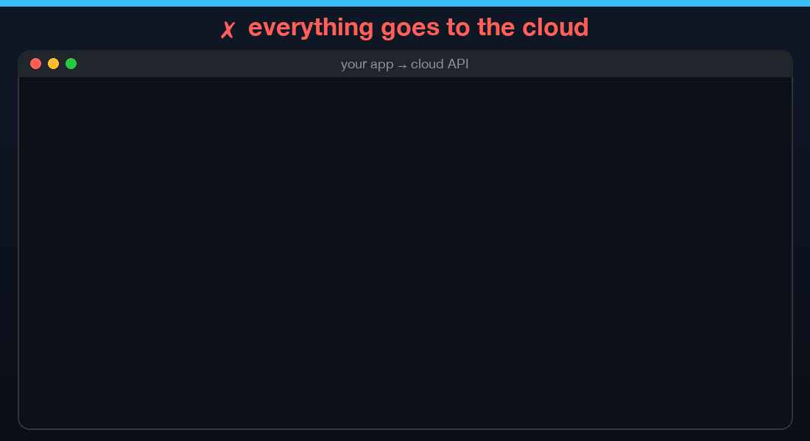

# local-first 本地优先路由

**每个请求去了哪、花了多少，你都知道。**
local-first 是一个 OpenAI 兼容的本地代理：按你写的明确规则，把每个请求分给本机的 LM Studio / Ollama 或云端，并把每一个都记进账本——去了哪、多少 token、估算花了多少。日常活留在本机，省下的云端费用是顺带的结果。

三条保证：

1. **带密钥的内容留在本机。** 提示词里有 API 密钥、私钥、密码，或者打了 `private` 标签，一律 `403` 拒绝，不会送去云端（默认开启，关掉要显式改配置）。
2. **本机挂了，明确报错，绝不悄悄转云。** 返回 `503`，写清楚哪里坏了、怎么办。
3. **任何转云都是你配置出来的结果，并写进账单。** 请求只会因为你写的某条规则、或你点名要云端而去云端；没有自动回落。每个请求——包括被拒的——在账本里都有一行，`bill` 就是从账本算出来的。

> 属于 [**hands-off（敢放手）**](https://github.com/JohnSUNLei/hands-off) 系列 —— 让 AI 替你干活也不出事的几个本地小工具。

[English](README.md)



```bash
curl -fsSL https://raw.githubusercontent.com/JohnSUNLei/hands-off/main/local-first/localfirst.py -o localfirst.py && python3 localfirst.py demo
```

一个文件，只用 Python 标准库。演示用的是本机上的假后端——不要密钥、不要模型，什么都不出本机。

## 用起来（2 分钟）

```bash
python3 localfirst.py init           # 生成 local-first.json，在里面填你的模型
python3 localfirst.py check --deep   # 实测：每个后端在不在、模型在不在、真能答出话吗？
python3 localfirst.py serve          # http://127.0.0.1:8484/v1
```

把任何 OpenAI 兼容的客户端指过来（OpenAI SDK、LangChain、Continue、Cline、aider、你自己的脚本），`model` 填 `"auto"`。每个响应都带着它在哪儿跑的：`X-Local-First-Where: local`、后端、模型、命中的规则。`python3 localfirst.py bill` 出本月**估算**账单（本机电费和算力不计入）。

## 三条保证（细则）

**一、带密钥的内容留在本机。** 打了 `private` 标签的请求（可配置 `keep_local_tags`），只要会去云端就直接 `403` 拒绝——哪怕规则指向云端、哪怕客户端点名要云端。`secrets_stay_local`（默认开）对看起来像 API 密钥、私钥、密码的提示词一视同仁。识别靠模式，是安全带，不是 DLP 系统（见「局限」）。

**二、绝不悄悄回落。** 本地后端挂了、或者模型没加载，请求直接返回 `503`，写清楚哪里坏了。**绝不**悄悄转去云端、不换别的模型、不拿缓存糊弄。云端后端失败返回 `502`，同样不会换去别处重试。很多网关把「自动回落」当卖点；对本地优先来说，它恰恰是「连着几周按云端价付钱却没发现」——或者「LM Studio 崩了那天，私密数据悄悄出了门」的来源。

模型也一样：`model` 必须出现在后端实时的 `/v1/models` 里；`model_hint` 必须恰好匹配一个模型。对不上或有歧义 → `503`，并列出当前真有的模型。`check --deep` 会真发一次单 token 推理，推理型模型回空内容（思考把预算吃光）也会被标红。

**三、转云是显式的，而且写进账单。** 请求只有两种方式去云端：你在 `local-first.json` 里写了指向云端的规则，或者客户端点名要云端（`model: "cloud"` 或标签 `cloud`）。没有自动回落这条路。每个请求——本机的、云端的、被拒的（`403`、`503`）——都会在账本 `~/.local-first/ledger.jsonl` 里追加一行（时间、后端、模型、命中的规则、token 数、估算花费、耗时），`bill` 就是从账本算出来的。

## 路由规则

`local-first.json` 里从上往下，第一条命中的生效，最后一条是默认：

| 条件 | 命中条件 |
|---|---|
| `tags` | 请求带这些标签之一——请求头 `X-Local-First-Tags: private,draft`、请求体 `"tags": [...]`、或 model 写 `"auto:private"` |
| `task` | 识别出的任务类型（`summarize` 总结、`translate` 翻译、`extract` 抽取、`classify` 分类、`code` 代码、`reasoning` 推理；中英文关键词，可在 `"tasks"` 里改），或请求头 `X-Local-First-Task` |
| `min_tokens` / `max_tokens` | 估算的提示词长度（英文约 4 字符 1 token，中日韩 1 字 1 token） |
| `has_images` / `has_tools` | 请求里有图片 / 有工具定义 |
| `model` | 对客户端请求的模型名做正则匹配 |
| `match` | 对最后一条用户消息做正则匹配 |

`python3 localfirst.py route "把这段翻译成西班牙语"` 不调用任何模型，直接告诉你它会去哪、每条规则为什么命中或没命中。

## 局限（说实话）

* **路由靠关键词和数字，不靠语义。** 写着「总结」就走本机，哪怕要总结的东西其实很难。换来的是：每个决定你都看得懂、预测得到。默认规则漏掉的，用标签或 `match` 补。
* **账单是估算，不是对账。** 价格是你配置里填的；token 数取后端返回的 `usage`（没有就估算并标 `*`）；「全走云端要付」是按 `compare_price` 算的假设。**本机电费、硬件折旧和算力都不计入**——本机那一行默认按 $0 算，不代表本机免费。还没拿真实云端发票核对过，所以只叫「估算账单」；等和发票对上（目标偏差 ≤2%）才会改叫「对账」。
* **只代理 `/v1/chat/completions`**（含流式）和 `/v1/models`，v0.1 不管 embeddings、图片、语音。
* **密钥识别靠模式**（常见密钥格式、私钥头、`password=`），是安全带，不是 DLP 系统。
* **单机、无鉴权。** 默认只监听 127.0.0.1，改了会警告。
* 在 macOS + Python 3.13 + LM Studio 上实测；需要 Python 3.9+。

## 系列：hands-off（敢放手）

专防「放手让 AI 干活之后会出的事故」的小工具，每个都是单文件、只用标准库、不调模型。

| 工具 | 防什么 |
|---|---|
| [rule-teeth 规则长牙](../rule-teeth/README.zh.md) | `CLAUDE.md` / `AGENTS.md` 里写了、AI 却悄悄不听的规则 |
| [send-fuse 发送保险丝](../send-fuse/README.zh.md) | 不该发出去的邮件和消息 |
| [tripwire 注入绊线](../tripwire/README.zh.md) | 网页里一行小字，骗 AI 把你的密钥发出去 |
| [blackbox 黑匣子](../blackbox/README.zh.md) | 「它昨晚到底干了什么？」—— 人话时间线 + 一键撤销 |
| [brake 刹车](../brake/README.zh.md) | AI 卡在死循环里烧一整晚的钱 |
| **local-first 本地优先** | 本机模型就能干的活，却花钱送去云端 |

⭐ 觉得有用，[给 hands-off 点个星](https://github.com/JohnSUNLei/hands-off)，系列更新第一时间看到。有问题、发现 bug，或者想给你团队的 AI 也装上这类护栏？[开个 issue](https://github.com/JohnSUNLei/hands-off/issues)。

[MIT 许可证](LICENSE)。
