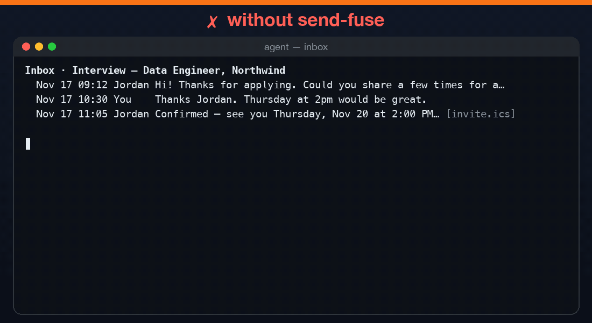

# send-fuse

**My AI agent replied to an email with three new times — for a meeting the other side had already confirmed. Twice.**
send-fuse is the fuse between your agent and the Send button: before anything goes out, it looks at the conversation *as it is now* and blocks the send a careful human wouldn't make.

> Part of [**hands-off**](https://github.com/JohnSUNLei/hands-off) — small, local guards that make it safe to let AI agents act for you.

[中文说明](README.zh.md)



```bash
curl -fsSL https://raw.githubusercontent.com/JohnSUNLei/hands-off/main/send-fuse/sendfuse.py -o sendfuse.py && python3 sendfuse.py demo
```

One file. Python standard library only. No model calls, no network, no account. send-fuse cannot send anything itself — it can only say no.

## Hook it into Claude Code (30 seconds)

```bash
python3 sendfuse.py init --claude --me you@yourdomain.com
```

This writes `.send-fuse/policy.json`, copies the engine to `.send-fuse/sendfuse.py`, and adds a `PreToolUse` + `PostToolUse` hook to `.claude/settings.json`. From then on, every tool whose name means *sending* — `mcp__gmail__send_message`, `…__reply`, `slack…chat_postMessage`, `…create_post`, `…add_issue_comment` — goes through the fuse first. Read tools (`get_*`, `list_*`, `search_*`, `create_draft`) are left alone.

When the fuse says no, Claude gets the reason and is told not to work around it:

```
send-fuse: BLOCKED  → jordan@acme.example  “Re: Project kickoff — Acme website redesign”
  ✗ already_settled  Jordan already confirmed this (Nov 17 11:05): “Confirmed — see you
                     Thursday, Nov 20 at 2:00 PM” — proposing times again would undo it.
  ✗ not_latest       You're answering the message of Nov 17 09:12, but 2 newer message(s)
                     exist (latest: Jordan, Nov 17 11:05).
  queued as #1 · review: send-fuse queue · override: send-fuse approve 1
```

Then tell it where the live conversation is (see [Thread sources](#thread-sources)) — that's what lets it see "already confirmed".

## What it checks

| Rule | Effect | Fires when |
|---|---|---|
| `already_settled` | block | The outgoing message proposes times / asks for availability, but someone in the thread already confirmed (a `.ics` invite, "Invitation:" / "Accepted:", "confirmed", "see you Thursday", "已确认", "到时见"…) |
| `not_latest` | block | The agent is answering a message that newer messages have overtaken |
| `already_replied` | block | The last message in the thread is ours and is younger than `followup_days` (default 3) — the ball is in their court |
| `same_thread` | block | An automatic send already went out on this conversation within `same_thread_hours` (default 24) — including one *in flight* from a parallel agent |
| `duplicate` | block | The very same message went to the same person within `duplicate_days` (default 7) |
| `thread_missing` | block | It's a reply, but the conversation can't be seen. Not sure → not sending |
| `thread_unreadable` | block | The thread source errored (missing file, script failed, bad JSON) |
| `daily_cap` | hold | `daily_cap` automatic sends already today (default 20) |
| `quiet_hours` | hold | Inside quiet hours (default 21:00–08:00, optional weekends) |
| `review` | ask | `review` is `always`, or `new_recipient` and this is someone new — a human previews it |

**block** = denied with the reason. **hold** = denied *and* parked in the queue, nothing lost. **ask** = Claude Code shows the user a preview (To / Subject / body) and asks. Everything that isn't sent lands in a review queue:

```bash
python3 sendfuse.py queue          # what's waiting, with previews and reasons
python3 sendfuse.py approve 3      # one-time override (valid 24 h) — then let the agent retry
python3 sendfuse.py drop 3
python3 sendfuse.py log            # what went out, by which agent
```

## How it works

```
agent wants to send ──► PreToolUse hook ──► take the send lock (local disk, one process at a time)
                                            read the live thread (thread source)
                                            read the ledger (what the fuse already let through)
                                            run the rules → allow / block / hold / ask
                                            allow: reserve in the ledger, release the lock
                     ◄── deny + reason ───  otherwise
tool runs ─────────► PostToolUse hook ────► mark the reservation "sent"
```

* **Deterministic.** Regular expressions, timestamps and a ledger. Same input → same verdict, every time. No model decides whether your email goes out.
* **The lock is real.** One exclusive file lock on *local* disk. send-fuse refuses to keep its state in Dropbox / iCloud / OneDrive / Google Drive folders, because file locks don't hold there — that is exactly how our two runs overlapped and sent the same email twice.
* **Record first, then send.** Six agents racing for the same thread: one gets through, five are blocked (there's a test for that).
* **Fails closed.** If the fuse itself breaks — bad policy, corrupt ledger, unreadable thread — sends are denied with the error. Non-send tools are never affected.

## Thread sources

The conversation-aware rules need to see the thread. Set one in `.send-fuse/policy.json`:

```json
{
  "me": ["you@yourdomain.com"],
  "thread_source": {"type": "maildir", "path": "~/Mail/INBOX"}
}
```

| type | for |
|---|---|
| `maildir` | mbsync / offlineimap / any local Maildir (threads by `References` / `In-Reply-To`, Gmail `X-GM-THRID`) |
| `mbox` | an mbox file (Thunderbird, Google Takeout, `mail`) |
| `json` | a file or folder of threads in a simple JSON shape (see `examples/thread.example.json`) |
| `command` | **anything else**: your script gets the outgoing message as JSON on stdin and prints the thread as JSON. Gmail API, Slack, Teams, a CRM — see `examples/fetch_thread_template.py` |

Without a source, the ledger rules (`same_thread`, `duplicate`, caps, quiet hours, the lock) still work, and replies are blocked with `thread_missing` until you configure one (or set `"require_thread_for_replies": false`).

## Without Claude Code

Any agent, any language — wrap the real send command:

```bash
send-fuse run --to sam@acme.com --subject "Re: Report" --body-file reply.txt --in-reply-to "<abc@acme.com>" \
  -- msmtp sam@acme.com < reply.txt
```

The command only runs if the fuse allows it; the lock is held throughout and a failed send releases its reservation. Or ask first: `send-fuse check ...` (exit 0 allow, 2 block, 3 hold, 4 ask; `--json` for machines).

From Python:

```python
from sendfuse import Fuse, Outgoing, Blocked

fuse = Fuse()                                   # finds .send-fuse/policy.json upward from cwd
try:
    with fuse.sending(Outgoing(to="sam@acme.com", subject="Re: Report", body=text, in_reply_to=mid)):
        smtp.send_message(msg)                  # runs only if allowed; recorded as sent
except Blocked as b:
    print(b.verdict.explain())
```

Install as a command: `pipx install "git+https://github.com/JohnSUNLei/hands-off#subdirectory=send-fuse"` (or just keep the one file).

## Policy

All keys are optional; unknown keys are an error (a typo shouldn't silently disable a rule).

| key | default | |
|---|---|---|
| `me` | `[]` | your addresses / handles — messages from these are "ours" |
| `thread_source` | `null` | see above |
| `require_thread_for_replies` | `true` | |
| `same_thread_hours` / `duplicate_days` / `followup_days` | `24` / `7` / `3` | |
| `daily_cap` | `20` | `0` = no cap |
| `quiet_hours` | `21:00–08:00`, `tz: "local"`, `weekends: false` | `null` = off; `tz` takes IANA names |
| `review` | `"off"` | `"always"` / `"new_recipient"` |
| `bash` | `"ask"` | shell commands that look like sending (`sendmail`, `mail -s`, `curl` to Slack / SendGrid / Mailgun / Telegram / X …): `"ask"` / `"block"` / `"off"` |
| `rules_off` | `[]` | e.g. `["quiet_hours"]` |
| `guard_tools` / `ignore_tools` | `[]` | regexes to force-include / exclude tool names |
| `state_dir` | OS cache dir | or `SENDFUSE_STATE_DIR`; must be local, unsynced disk |

## Limitations (honest ones)

* **Signals are patterns, not understanding.** Confirmation and scheduling phrases are English and Chinese regexes plus calendar markers. A confirmation phrased in a way the patterns don't know won't be seen; a rule can be switched off if it misfires for you. Pull requests with new phrasings (and a test) are the best contribution.
* **It only knows the thread you let it read.** No source → no `already_settled`. The `command` source is the bridge to Gmail API / Slack / anything; v0.1 ships no IMAP client.
* **Tool names are matched by verbs** (`send`, `reply`, `post`, `forward`, `publish`, `comment`…). An MCP tool called `do_it` that sends email won't be caught — add it to `guard_tools`.
* **Shell detection is a heuristic.** A send hidden inside a script is invisible to it.
* **In-flight reservations expire after `reserve_minutes`** (10) unless the `PostToolUse` hook confirms them — keep both hooks installed (`init --claude` does).
* **Not a spam filter or an inbox assistant.** It decides *whether now is a good moment to send this*, nothing else.
* Tested on macOS with Python 3.13; needs Python 3.9+. Windows uses `msvcrt` locking and is untested.
* The hook is tested live in Claude Code 2.1 (Haiku) against a fake MCP mail server — the incident is blocked, a normal email goes out, an immediate repeat is blocked: `bash examples/live-claude-code/run.sh` (well under $0.01; sends nothing).

## Part of hands-off

Small, deterministic, local tools for the accidents that happen once you let AI agents act for you. One file each, standard library only, no model calls.

| tool | stops |
|---|---|
| [rule-teeth](../rule-teeth) | the rules in `CLAUDE.md` / `AGENTS.md` that the agent quietly ignores |
| **send-fuse** | an email or message that should never have gone out |
| [tripwire](../tripwire) | a web page talking your agent into leaking your keys |
| [blackbox](../blackbox) | "what did it do all night?" — a plain-language timeline, and undo |
| [brake](../brake) | a stuck agent burning money all night |
| [local-first](../local-first) | paying the cloud for work a model on your machine could do |

⭐ [Star hands-off](https://github.com/JohnSUNLei/hands-off) to follow the series. Questions, bugs, or want guardrails like these around your team's agents? [Open an issue](https://github.com/JohnSUNLei/hands-off/issues).

[MIT License](LICENSE).
