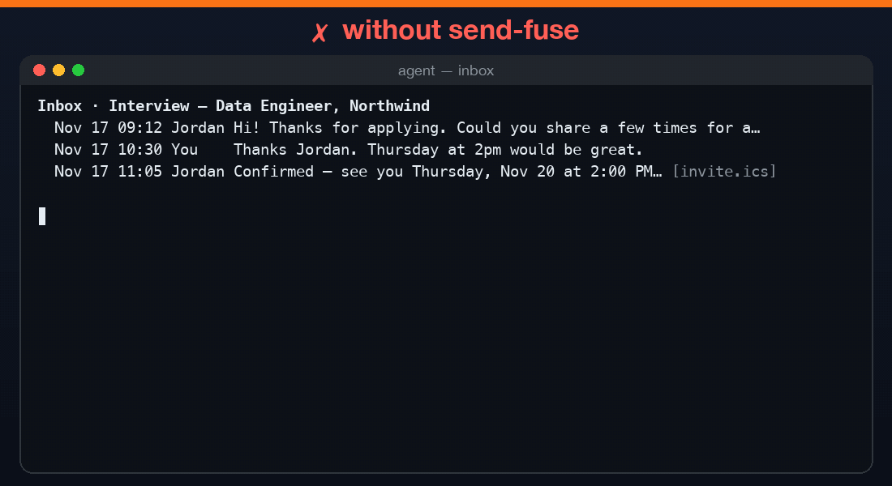

# send-fuse 发送保险丝

**我的 AI 给一位已经确认了面试时间的招聘官，又发了一封「约个时间吧」的邮件。还发了两次。**
send-fuse 装在 AI 和「发送」按钮之间：发出去之前，先看一眼这个会话**现在**是什么状态，细心的人不会按发送的时候，它就不让发。

> 属于 [**hands-off（敢放手）**](https://github.com/JohnSUNLei/hands-off) 系列 —— 让 AI 替你干活也不出事的几个本地小工具。

[English](README.md)



```bash
curl -fsSL https://raw.githubusercontent.com/JohnSUNLei/hands-off/main/send-fuse/sendfuse.py -o sendfuse.py && python3 sendfuse.py demo
```

一个文件，只用 Python 标准库。不调模型、不联网、不用注册。send-fuse 自己发不了任何东西——它只会说「不」。

## 接进 Claude Code（30 秒）

```bash
python3 sendfuse.py init --claude --me 你的邮箱@example.com
```

它会写 `.send-fuse/policy.json`，把引擎复制到 `.send-fuse/sendfuse.py`，并在 `.claude/settings.json` 里加上 `PreToolUse` + `PostToolUse` 两个 hook。之后凡是名字意思是「发出去」的工具——`mcp__gmail__send_message`、`…__reply`、Slack 的 `chat_postMessage`、`…create_post`、`…add_issue_comment`——都要先过保险丝。读类工具（`get_*`、`list_*`、`search_*`、`create_draft`）不受影响。

保险丝说不的时候，Claude 会收到原因，并被告知不要换个说法绕过去。然后告诉它去哪儿读会话（见下面「会话来源」）——有了这个，它才看得见「对方已经确认了」。

## 检查哪些事

| 规则 | 结果 | 什么时候触发 |
|---|---|---|
| `already_settled` | 拦下 | 要发的内容在约时间 / 问对方什么时候有空，但会话里已经有人确认了（`.ics` 日历邀请、「Invitation:」/「Accepted:」、confirmed、see you Thursday、已确认、到时见……） |
| `not_latest` | 拦下 | AI 在回一封旧信，后面已经有更新的邮件了 |
| `already_replied` | 拦下 | 会话最后一封是我们发的，且不到 `followup_days`（默认 3 天）——球在对方手里 |
| `same_thread` | 拦下 | 这个会话在 `same_thread_hours`（默认 24 小时）内已经自动发过——包括另一个 agent **正在发**的 |
| `duplicate` | 拦下 | 一模一样的内容 `duplicate_days`（默认 7 天）内已经发给同一个人 |
| `thread_missing` | 拦下 | 这是回复，但看不到它属于哪个会话。拿不准就不发 |
| `thread_unreadable` | 拦下 | 会话来源出错（文件不在、脚本失败、JSON 坏了） |
| `daily_cap` | 暂扣 | 今天已经自动发了 `daily_cap` 封（默认 20） |
| `quiet_hours` | 暂扣 | 免打扰时段（默认 21:00–08:00，可选周末） |
| `review` | 问人 | `review` 设成 `always`，或 `new_recipient` 且是第一次联系的人——先给人预览 |

**拦下** = 拒绝并说明原因。**暂扣** = 拒绝，同时放进队列，不会丢。**问人** = Claude Code 弹出预览（收件人 / 标题 / 正文）让你决定。所有没发出去的都进预览队列：

```bash
python3 sendfuse.py queue          # 在等什么，带预览和原因
python3 sendfuse.py approve 3      # 人工放行一次（24 小时内有效），然后让 AI 重试
python3 sendfuse.py drop 3
python3 sendfuse.py log            # 发出去了什么、是哪个 agent 发的
```

## 原理

* **确定性。** 正则、时间戳、台账。同样的输入永远同样的结论。你的邮件发不发，不由模型决定。
* **锁是真锁。** 本机磁盘上的一把排他文件锁，同一时间只有一个进程在发。send-fuse 拒绝把状态放在 Dropbox / iCloud / OneDrive / Google Drive / 同步盘里——同步盘上文件锁不可靠，我们那次「同一封信发了两遍」就是这么来的。
* **先记账，再发送。** 六个 agent 同时抢着回同一个会话：一个通过，五个被拦（有测试）。
* **坏了就关门。** 保险丝自己出错（配置坏了、台账坏了、读不到会话），发送一律拒绝并报错；不是发送的工具永远不受影响。

## 会话来源

| 类型 | 适用 |
|---|---|
| `maildir` | mbsync / offlineimap 等本地 Maildir（按 `References` / `In-Reply-To` 归并会话，支持 Gmail `X-GM-THRID`） |
| `mbox` | mbox 文件（Thunderbird、Google Takeout） |
| `json` | 简单 JSON 格式的会话文件或目录（见 `examples/thread.example.json`） |
| `command` | **其它一切**：你的脚本从 stdin 收到待发消息的 JSON，打印出会话 JSON。Gmail API、Slack、Teams、CRM 都行——见 `examples/fetch_thread_template.py` |

没配来源时，台账类规则（同会话、重复、限额、免打扰、锁）照常工作；回复会被 `thread_missing` 拦下，直到你配好来源（或设 `"require_thread_for_replies": false`）。

## 不用 Claude Code 也能用

任何 agent、任何语言，包住真正的发送命令即可：

```bash
send-fuse run --to sam@acme.com --subject "Re: Report" --body-file reply.txt -- msmtp sam@acme.com < reply.txt
```

只有保险丝放行，命令才会执行；全程持锁，发送失败会释放预留。Python 里用 `with Fuse().sending(Outgoing(...)):` 包住发送代码。

## 局限（说实话）

* **信号是模式，不是理解。** 「已确认」「在约时间」靠中英文正则加日历标记识别，没见过的说法认不出来；误判可以按规则关掉。欢迎带测试的 PR 补充新说法。
* **它只知道你让它读的会话。** 没配来源，就没有 `already_settled`。v0.1 不带 IMAP 客户端，用 `command` 来源接 Gmail API / Slack 等。
* **工具名按动词识别**（send、reply、post、forward、publish、comment……）。一个叫 `do_it` 却在发邮件的工具认不出来——加进 `guard_tools`。
* **Shell 命令识别是经验规则**，藏在脚本里的发送看不见。
* **预留的「正在发送」10 分钟后过期**，除非 `PostToolUse` hook 确认已发——两个 hook 都要装（`init --claude` 会装好）。
* 在 macOS + Python 3.13 上测试；需要 Python 3.9+。Windows 用 `msvcrt` 加锁，未实测。
* hook 已在真实 Claude Code 2.1（Haiku）里对着假 MCP 邮件服务器实测：事故那封被拦、正常邮件发出、紧接着重发被拦——`bash examples/live-claude-code/run.sh`（花费不到 1 美分，什么都不会真发）。

## 系列：hands-off（敢放手）

专防「放手让 AI 干活之后会出的事故」的小工具，每个都是单文件、只用标准库、不调模型。

| 工具 | 防什么 |
|---|---|
| [rule-teeth 规则长牙](../rule-teeth/README.zh.md) | `CLAUDE.md` / `AGENTS.md` 里写了、AI 却悄悄不听的规则 |
| **send-fuse 发送保险丝** | 不该发出去的邮件和消息 |
| [tripwire 注入绊线](../tripwire/README.zh.md) | 网页里一行小字，骗 AI 把你的密钥发出去 |
| [blackbox 黑匣子](../blackbox/README.zh.md) | 「它昨晚到底干了什么？」—— 人话时间线 + 一键撤销 |
| [brake 刹车](../brake/README.zh.md) | AI 卡在死循环里烧一整晚的钱 |
| [local-first 本地优先](../local-first/README.zh.md) | 本机模型就能干的活，却花钱送去云端 |

⭐ 觉得有用，[给 hands-off 点个星](https://github.com/JohnSUNLei/hands-off)，系列更新第一时间看到。有问题、发现 bug，或者想给你团队的 AI 也装上这类护栏？[开个 issue](https://github.com/JohnSUNLei/hands-off/issues)。

[MIT 许可证](LICENSE)。
